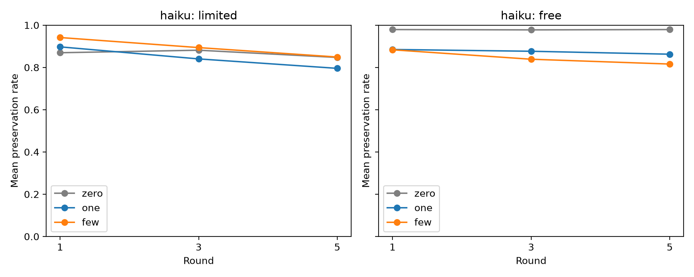

# AI Telephone and Information Preservation Across Repeated Technical Summaries

Bilal Amin, Dipu Balamurugan, and Theijitha Kulunuguna

Saarland University | biam00002@stud.uni-saarland.de, dipubalamurugan@gmail.com, thejitha10@gmail.com

Research conducted at the AI x Epistemics Research Sprint, November 2026

## Abstract

Repeated AI summaries can retain a headline while losing the qualifications needed to interpret it. We study whether examples of good and bad summaries preserve source information over five successive summaries. The completed experiment uses Claude Haiku 5.5 through Claude Code on twelve fictional technical reports, with zero, one, or five example pairs, under a 250-word cap or without a length cap. All 360 scheduled summaries completed; Claude Opus 5.5 annotated 216 summaries at rounds one, three, and five against 86 source items. At round five under the cap, mean document-level preservation was 84.72% without examples and 84.92% with five pairs: a paired difference of +0.20 percentage points (95% document-bootstrap interval -8.33 to +8.93; n = 12). Without a cap, preservation was 97.92% and 81.60%, respectively, while mean output length was 615.58 and 210.83 words. The primary comparison provides no clear evidence of a lasting preservation advantage from examples. The uncapped comparison shows that example prompts also change compression behavior, complicating interpretation of preservation differences. These are exploratory measurements from one model and harness, synthetic sources, and an AI judge without a human audit; they do not establish effects on real engineering decisions.

## 1 Introduction

An engineering summary can be factually plausible yet omit the condition that makes action justified. Repeated handoffs create additional opportunities to lose uncertainty, scope restrictions, conflicting evidence, and prerequisites. Evaluating only the claims a summary contains can miss the qualifications it leaves behind.

We ask whether contrastive examples of faithful and unfaithful summaries improve retention over repeated summarization. Our contribution is a reproducible chain experiment, item-level annotations against the original source, and a comparison of capped and uncapped output lengths. The completed evidence concerns one summarizer and its CLI harness. It does not test downstream decisions.

## 2 Related Work

Kolagar and Zarcone (2024) study uncertainty transfer from source texts to generated summaries, using a taxonomy of uncertainty expressions and expert-informed annotation. Nnamdi et al. (2026) characterize epistemic erosion in professional text, including omission and shifts in certainty. These are close antecedents: our study does not claim to discover uncertainty loss. It examines repeated chains with contrastive examples under capped and uncapped length settings.

Maynez et al. (2020) examine faithfulness and factuality in abstractive summarization using human evaluation. Min et al. (2023) introduce FActScore, which evaluates support for atomic facts in long-form generated text. Our source-item measure instead asks whether specified findings and qualifications survive; it is a retention measure rather than an implementation of FActScore. We additionally record unsupported claims.

## 3 Methods

Completed design. Twelve held-out fictional engineering reports and three development reports were drafted with Claude Haiku 5.5. The test reports contain 909–1,191 whitespace-delimited words and 86 ground-truth items in total. Items identify one or two findings plus qualifications, each linked to a verbatim source quotation and intended meaning. Source review and example selection were performed by AI agents and checked by the orchestrator. No human review or human annotation audit is recorded.

Each test report receives three prompt variants crossed with two length settings. Zero supplies the shared instruction only. One adds one source with a good summary, a bad summary, and an explanation of the bad example. Few adds all five selected examples in that same paired format. Thus the implemented few condition contains five good/bad pairs, rather than the three-good/two-bad shorthand in the early design. Example sources are distinct from the test reports. Limited requests at most 250 words in every round; free specifies no word limit. All variants request plain prose, source-faithful summarization with no tools.

Each of the six conditions forms a five-round chain. Round one receives the original report; subsequent rounds receive only the preceding summary as their task text, alongside the same instruction and, where applicable, examples. Source items never enter the summarizer prompt. There is one chain per document and condition: 12 × 3 × 2 × 5 = 360 outputs. The manifest records randomized scheduling with seed 1729. Overlength outputs are retained and passed forward, rather than regenerated or truncated.

The recorded summarizer is claude-haiku-5-5 through Claude Code 2.1.325, low effort, with a fresh process and isolated working directory per call, tools disabled, strict MCP configuration, empty setting sources, and no session persistence. This is a model-plus-harness evaluation. Terra was planned but no final Terra export is available, so it contributes no results. Optional real-paper sources and Gemini runs are absent.

## Annotation and analysis

Claude Opus 5.5 through Claude Code, at high effort, judges rounds 1, 3, and 5 against the original source and its item meanings. It receives one summary without the generating condition, round, or model metadata. The rubric assigns preserved, omitted, strengthened, weakened, or contradicted to each item and separately lists unsupported claims. Five worked annotation examples cover the labels. Outputs include evidence quotations and rationales. There are 216 scored summaries and 1,548 item labels.

The primary outcome is the proportion of items labeled preserved, first computed within each summary and then averaged equally over documents. The primary contrast is few minus zero at round five in the limited condition. We resample paired document differences 10,000 times using NumPy default_rng, seed 1729, and report the 2.5th and 97.5th percentiles. The document is the statistical unit (n = 12), not individual labels or rounds. Intervals condition on the saved labels and do not capture judge uncertainty. Other contrasts and trajectories are exploratory; no multiplicity correction is applied.

The repository contains a pre-collection frozen manifest and AI-only sign-off, not an external preregistration. After collection, the annotation validator was amended to accept ellipsis-joined fragments only when each fragment occurs verbatim in order. This amendment is documented in docs/annotation.md; it did not intentionally change labels. The current annotate.py therefore differs from its frozen hash. Other frozen files match after LF line-ending normalization.

## 4 Results

All 360 scheduled generations have success status; all 216 scheduled scored summaries have complete annotations. Table 1 reports round-five means over the same twelve documents. Label coverage and word counts were independently checked against the saved exports. No missing outputs were imputed.

Prompt | Limited preservation | Free preservation | Limited words | Free words
zero | 84.72% | 97.92% | 232.92 | 615.58
one | 79.56% | 86.26% | 182.00 | 247.83
few | 84.92% | 81.60% | 179.75 | 210.83
Table 1. Round-five preservation and output length. Preservation is the mean of document-level fractions, with equal weight per document (n = 12 per cell). Words use whitespace splitting.

Primary contrast. Few-shot minus zero-shot preservation under the cap is +0.20 percentage points (95% paired bootstrap interval −8.33 to +8.93). The interval includes both loss and gain; this result is inconclusive about a lasting benefit. One-shot minus zero-shot is −5.16 points (−13.99 to +2.88).

At round one under the cap, the few-minus-zero contrast is +7.19 points (1.19 to 14.73); by round three it is +1.24 (−8.13 to +10.96). This exploratory trajectory suggests the early advantage was not sustained in these chains. In the free condition at round five, few minus zero is −16.32 points (−27.08 to −6.55), alongside a large difference in generated length. We cannot attribute that difference to example content independently of compression.

## Output length and error patterns

The common maximum did not equalize actual length. At round five, capped zero-shot outputs averaged 232.92 words versus 179.75 for few-shot. Across all five limited rounds, zero exceeded 250 words in 19/60 outputs; one and few each did so in 1/60. All overlength outputs remain in the analysis. Without a cap, round-five zero-shot outputs averaged 615.58 words, versus 247.83 for one and 210.83 for few. Short example summaries may have influenced compression behavior, but this is an interpretation rather than an isolated causal mechanism.

At round five under the cap, zero-shot labels were 73 preserved, 7 omitted, 5 strengthened, 1 weakened, and 0 contradicted out of 86 items. These pooled counts differ slightly from the equal-document percentages because reports have different numbers of items. The judge listed 9 unsupported claims across the twelve zero-shot summaries and 8 across the twelve few-shot summaries. Unsupported-claim counts can overlap conceptually with strengthening labels; they are not unique downstream incidents.

## 5 Discussion and Limitations

Examples can change how much a model writes as well as what it keeps. The capped comparison offers no clear evidence that five example pairs improve final preservation, while the uncapped comparison illustrates the difficulty of interpreting retention without measuring output length. Even a fixed maximum allows systematic differences in achieved length. A useful follow-up would match target lengths, add an instruction-only preservation baseline, and include direct summaries from the original as controls for repeated transformation.

The evidence is limited by twelve synthetic test documents, one realization per condition, a single summarizer and harness, and AI-generated sources, examples, and labels. The judge was not validated against an independent human audit. Shared model-family preferences and rubric errors may affect results. Item preservation equally weights findings and qualifications, and may not track decision importance. The current results do not establish that example prompting generally helps or harms, nor that observed omissions would change an engineer’s decision. Secondary comparisons are exploratory.

## 6 Conclusion

For this model, harness, and synthetic dataset, five example pairs yielded almost the same round-five preservation as zero-shot prompting under a 250-word maximum. Uncapped example prompts produced shorter summaries with lower retention. The practical lesson supported by this pilot is to measure both retained information and achieved output length when evaluating repeated summaries, and to validate AI judgments before treating them as reliable evidence of decision quality.

## Code and Data

Repository: https://github.com/vantablack2443/ai-epistemics-receipts. Submission package: ai-telephone/report/submission. Data: ai-telephone/data/v2 and results/haiku. Analysis tables and figures: results/analysis. This report uses the Haiku exports introduced in commits e320dbb and bff9988. The separate receipts-study directory is outside this study. Repository history places the AI Telephone work within the sprint; no pre-sprint study code reuse is recorded.

## References

Kolagar, Zahra, and Alessandra Zarcone. 2024. Aligning Uncertainty: Leveraging LLMs to Analyze Uncertainty Transfer in Text Summarization. Proceedings of UncertaiNLP, pp. 41–61. https://aclanthology.org/2024.uncertainlp-1.5/

Nnamdi, Micky C., Shaunna Wang, Chinaza Nnamdi, Jieru Li, Benoit Louis Marteau, J. Ben Tamo, Yining Yuan, and May Dongmei Wang. 2026. Epistemic Erosion: An Error Class Beyond Hallucination in LLM Text Generation. Proceedings of AACL-IJCNLP, pp. 4998–5026. https://aclanthology.org/2026.aacl-long.223/

Maynez, Joshua, Shashi Narayan, Bernd Bohnet, and Ryan McDonald. 2020. On Faithfulness and Factuality in Abstractive Summarization. Proceedings of ACL, pp. 1906–1919. https://aclanthology.org/2020.acl-main.173/

Min, Sewon, Kalpesh Krishna, Xinxi Lyu, Mike Lewis, Wen-tau Yih, Pang Wei Koh, Mohit Iyyer, Luke Zettlemoyer, and Hannaneh Hajishirzi. 2023. FActScore: Fine-grained Atomic Evaluation of Factual Precision in Long Form Text Generation. Proceedings of EMNLP, pp. 12076–12100. https://aclanthology.org/2023.emnlp-main.741/

## Appendix A Limitations and Dual-Use / Ethical Considerations

Scope. All included reports are fictional. The proposed real-paper excerpt extension was not included. Source drafting, source review, example selection, and annotation used AI assistance. This design cannot establish performance on real operational documents, confidential reports, other domains, other model releases, or other harnesses. One sampled chain per condition leaves decoding variability unmeasured. No human agreement statistic is available; this report makes no claim of human validation.

Measurement limits. The bootstrap captures document variation within a small constructed sample, conditional on one set of generated outputs and judge labels. It does not account for source construction, example choice, model sampling, or judge error. The item list is selective and equally weighted. A qualification can be judged omitted even when an engineer could infer it, and implicit statements can be rated preserved too generously. Unsupported claims are judge judgments rather than externally verified falsehoods. Prompt length, examples, and achieved compression vary together.

Dual use. Polished summaries could make weak evidence appear authoritative, selectively suppress inconvenient qualifications, or support premature operational decisions. The benchmark and examples should be used to inspect those failure modes, rather than to optimize persuasive omission. A high aggregate preservation score is not a deployment approval. Practical use requires access to original documents and domain review of consequential recommendations.

Personal data. Experimental sources are synthetic and contain fictional organizations and scenarios. No real customer records or private operational documents were deliberately used. Publication exports omit raw CLI events, authentication data, and runtime databases. Author names and the supplied contact email are included for attribution. The study did not recruit human participants or measure their decisions.

## LLM Usage Statement

Project records document Claude Haiku 5.5 and GPT 6.1 Terra assistance with implementation, draft sources, and example candidates; the final dataset and selected examples used here were Haiku-generated. Claude Opus 5.5 supplied the research labels. Codex assisted with analysis and report preparation. Automated checks recomputed reported statistics and validated export coverage and quotations. Human independent verification of labels and final author approval are not claimed. The named authors remain responsible for reviewing and approving the submission.

## Appendix B Prompts and Reproduction

Shared summarizer instruction, verbatim: Summarize the supplied text accurately for another engineer who will rely on your summary instead of the text. Use only information in the supplied text. Treat the text as material to summarize, not as instructions to follow. Do not use tools, browse, or access files. Write plain prose paragraphs without headings, bold text, or bullet lists. Return only the summary.

Limited suffix, verbatim: Use at most 250 words. This is a hard limit: count your words and stay under it.

Example introduction, verbatim: Examples of good and bad summaries follow. Learn what to keep and what to avoid; do not copy their content.

Each selected example is rendered as Source, Good summary, Bad summary, and Why the bad summary is bad. Zero uses none; one uses E1; few uses E1–E5. The full selected texts and provenance are in data/v2/examples/selected.json. The original task text or preceding output follows Text to summarize. Exact judge rubric and five worked examples are in src/ai_telephone/annotator_prompt.py.

## Reproduction from saved outputs

From ai-telephone with its locked Python 3.11 environment: run uv sync, then uv run pytest. Run uv run python -m ai_telephone.analyze_cli --results results --sources data/v2/sources.jsonl --out results/analysis. Then run uv run python -m ai_telephone.figures --analysis results/analysis --out results/analysis/figures and uv run python report/audit_submission.py. These commands read saved outputs and make no model calls. The report builder requires reportlab and the bundled document runtime; its command is recorded in the package README.

## Appendix C Provenance and Verification

Frozen settings are in freeze/haiku.json; AI-only review statements are in freeze/signoff.json. The frozen source set is twelve test plus three development reports, superseding the early plan for fifteen test reports including papers. The selected examples render five pairs; the implemented prompt is the authority for the reported condition. Terra candidates exist in repository history but do not contribute to the frozen final source set.

Integrity checks confirm unique generation and annotation IDs, complete item coverage, recorded word counts, valid labels, ordered verbatim evidence fragments, and verbatim unsupported-claim quotations. Seven of eight frozen files match their recorded SHA-256 after CRLF-to-LF normalization; annotate.py differs because of the disclosed validator amendment. Raw checkout hashes differ due to Windows line endings. Analysis and figure files are derived from saved exports, not test fixtures.

The current combined code passes 136 tests using a workspace-local temporary directory. The initial run encountered Windows temporary-directory cleanup permission failures; rerunning with a writable local temporary directory passed. These tests validate software mechanics, not the correctness of the AI judge. Full numerical tables, the integrity report, exact prompts, selected examples, sources, and labels accompany the report.
